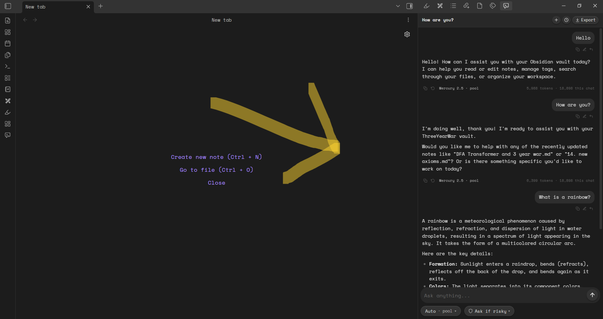
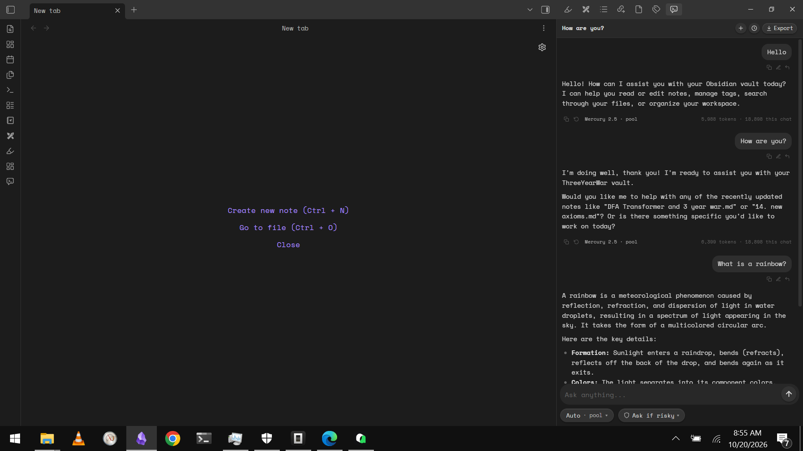

# Free AI and Agents

  
  

Free AI chat and vault-editing agents in your Obsidian sidebar. No account, no signup, and no API key needed to start — you get a free monthly token allowance from [usefree.space](https://usefree.space). Bring your own key if you want to use other providers.

## Features

- **Free pool** — pick a pool model and chat with no account and no key. Mercury 2.5 is offered in thinking levels — **Medium**, **High**, **Low** and **Off** — so you choose speed or depth.
- **Model-written conversation titles** — the chat header is named by the model you are already using, not by a guess from your first message.
- **Agents that edit your vault** — create, rewrite, move and tag notes through tools, with an approval step before anything is changed.
- **Chat and agent modes** — ask questions, or let the agent act with tools such as read, search, write, move, tags, properties and canvas.
- **Web tools** — `web_read` and `web_search` let the model read a page or search the web, using the free web allowance or your own Jina key.
- **20+ other providers** — add your own key for OpenAI, Anthropic, Gemini, Groq, OpenRouter, Mistral and more.
- **Voice typing** — optional dictation with your own Groq key.
- **Local history and snapshots** — a change history with restore, and chats you can export.

## Install

### From the Obsidian community directory

Once published: **Settings → Community plugins → Browse**, search for **Free AI and Agents**, then **Install** and **Enable**.

### Manually

1. Download `main.js`, `manifest.json` and `styles.css` from the latest release.
2. Put them in `<your vault>/.obsidian/plugins/free-ai-agents/`.
3. Reload Obsidian, then enable **Free AI and Agents** under **Settings → Community plugins**.

## How the free allowance works

- The free pool gives each device a monthly token allowance. No account or email is needed.
- The web tools give each device a monthly web allowance, and are capped per network as well.
- When an allowance runs out, the plugin tells you the reset time and links to [usefree.space](https://usefree.space) for free keys, promos and deals from many other AI services.
- Adding your own key (for any provider, including Jina) routes requests to that provider directly and skips the free allowance for that feature.

## Network use

This plugin needs the network for the features below. Nothing else is sent anywhere.

- **`https://api.usefree.space`** — the free pool and the free web tools. Requests are anonymous and are identified only by a random device ID generated on first run.
- **The provider you configure** — if you add your own API key, requests go straight to that provider under your key.
- **`https://r.jina.ai` and `https://s.jina.ai`** — only if you add your own Jina key for the web tools.
- **`https://api.usefree.space/api/catalog.json`** — the model and deals catalog shown in the plugin.

Optional network features, off unless you turn them on: voice typing (Groq), and the model-written conversation titles (uses the free pool or your own provider).

## Privacy

- No account, no email, and no client-side telemetry.
- The plugin stores its settings, your API keys (only if you turn on "Remember keys"), and your chats inside your vault.
- To enforce the free allowance, our server records a random device ID together with token counts and timestamps. It is not linked to your identity, your vault, or the content of your messages.
- Requests you make to other providers are governed by those providers' policies.

See the privacy policy at [usefree.space/privacy](https://usefree.space/privacy).

## Permissions and safety

- The agent only touches your vault, and only after you approve each change (approval mode is configurable).
- A power-user `eval_js` tool can run JavaScript inside Obsidian. It is off by default and requires you to enable it in the settings.
- Tool results from your notes and from the web are treated as untrusted data.

## License

MIT. See [LICENSE](LICENSE).

## Links

- Website: [usefree.space](https://usefree.space)
- Issues: [GitHub issues](https://github.com/mokelu/free-ai-agents/issues)
